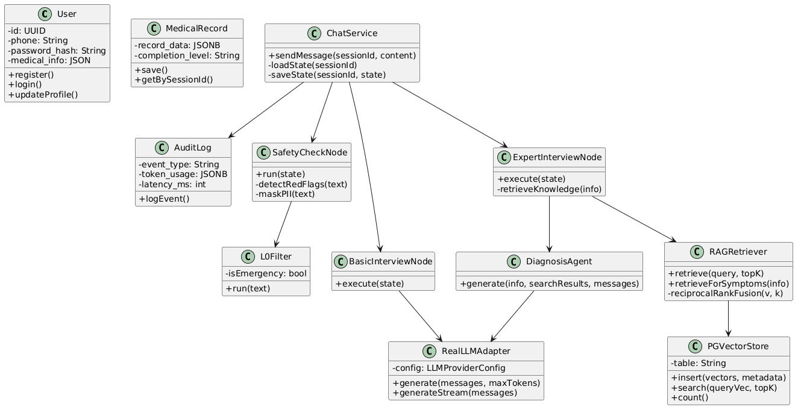
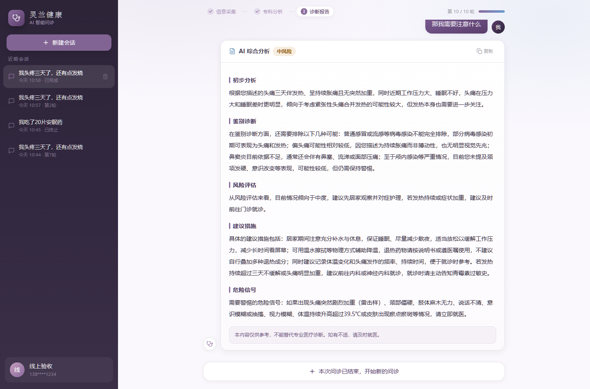

# 灵兰健康 · AI 智能问诊系统

> 一个基于 LangGraph 多阶段工作流与 RAG 的医疗问诊 Demo：先安全、再问诊、后分析，
> 全过程有审计、有评测、可部署。

- 在线演示：`http://<服务器公网IP>:8080`
- 技术栈：FastAPI · LangGraph · PostgreSQL + pgvector · Vue 3 · Docker
- 项目性质：个人项目，用于技术验证与演示，**无真实用户**，不构成医学诊断

---

## 1. 要解决的问题

通用大模型直接回答医疗问题，工程上有三个绕不开的问题：

1. **安全边界依赖「概率」而不是「流程」**。现在的模型普遍做过安全对齐，危险内容大多会拒绝或提示就医，这是有价值的进步；但本质上仍是模型自己的判断，属于**软约束**——用户说「我吃了 20 片安眠药」时，系统无法保证它一定停止追问、一定给出急救指引。本项目的做法是把红线做成 **LLM 之外的前置规则**：命中即终止会话并返回固定急救话术，不依赖模型是否"想起来"。
2. **信息采集不完整**。一句话主诉就想要结论，缺少起病时间、伴随症状、既往史、过敏史等关键要素。系统采用**阶段性串行问诊**：先基础采集、再专科追问、最后才出报告，并用选择题式交互降低用户的表达成本。
3. **过程和依据不可追溯**。回答引用了哪些知识、有没有触发安全规则、每一步耗时多少，如果没有记录，既无法复盘也无法迭代。系统把会话状态、消息、安全事件、结构化病历全部落库。

这个项目的目标不是"让模型更聪明"，而是把问诊拆成一条**可控、可审计、可评测**的流水线：安全检测 → 结构化采集 → 知识增强追问 → 综合报告。

---

## 2. 系统架构

```
                    ┌──────────────────────────────┐
                    │  Vue 3 + Tailwind 前端        │
                    │  登录 / 会话 / 选项式问诊 / 报告 │
                    └───────────────┬──────────────┘
                                    │ /api/v1 (JWT)
                    ┌───────────────▼──────────────┐
                    │  nginx（限流 / 缓存 / 反代）    │
                    └───────────────┬──────────────┘
                                    │
        ┌───────────────────────────▼───────────────────────────┐
        │                    FastAPI 应用                        │
        │  ┌─────────────────────────────────────────────────┐  │
        │  │            LangGraph 四阶段工作流                 │  │
        │  │                                                 │  │
        │  │  safety_check ──▶ basic_interview（循环）        │  │
        │  │       │                    │                    │  │
        │  │       │ red_flag           ▼                    │  │
        │  │       │            expert_interview（循环+RAG）  │  │
        │  │       ▼                    │                    │  │
        │  │   response ◀───────────────┘                    │  │
        │  └─────────────────────────────────────────────────┘  │
        │                                                        │
        │  会话状态 / 消息 / 审计 / 病历  →  PostgreSQL + pgvector │
        └────────────────────────────────────────────────────────┘
                                    │
                          DeepSeek API（OpenAI 兼容）
```



### 四阶段工作流

| 阶段 | 做什么 | 关键设计 |
|---|---|---|
| `safety_check` | 每条输入先过 L0 规则 | 自杀/急症/过量服药三类红线直接终止会话；PII 就地脱敏 |
| `basic_interview` | 按病史采集顺序追问 | 每轮只问一个问题，强制生成 4 个选项；记录已问问题防重复 |
| `expert_interview` | 检索知识库后追问 | 每轮检索 top-5，把知识注入 prompt 设计鉴别诊断选项 |
| `response` | 生成结构化报告 | 强制追加免责声明；诊断完成后写结构化病历 |

状态用 LangGraph 的 `StateGraph` 承载，三种 reducer 并存：
`add_messages`（对话历史）、自研 `dict_merge`（采集信息/知识片段增量合并）、默认覆盖（阶段、轮次）。

---

## 3. 核心能力

### 3.1 安全前置（L0）

- **红线规则**：自杀意图、急诊体征（胸痛/呼吸困难/抽搐/口唇发紫…）、药物过量，命中即返回急救话术并终止会话，后续消息一律拦截。
- **口语化适配**：规则同时覆盖「胸痛」和「胸口剧痛 / 喘不上气」这类说法（这是评测时发现的真实缺口，见第 5 节）。
- **PII 脱敏**：身份证、手机号、邮箱等在前端和后端各做一次，写库与写审计的都是脱敏后的文本。

### 3.2 RAG 检索

- 知识库 24 条（发热、头痛、胸痛、卒中、儿童发热、妊娠腹痛等），带来源、类型、年份、权威分。
- 向量模型 `bge-small-zh-v1.5`（512 维）随镜像离线打包，无需外部 embedding 服务。
- 混合检索：向量召回 + 关键词召回，用 **RRF** 融合，再按权威度/时效性重排。
- 无 API Key、无外网也能跑，适合自托管。

### 3.3 结构化问诊

- 每轮输出 JSON，经 **Pydantic 校验 + 四步 JSON 修复 + 重试 + 兜底**，坏输出不会把流程带崩。
- `asked_questions` 记录已问问题；同一问题问满两次仍无进展时，强制推进阶段，避免死循环。
- 采集结果以 `patient_info` 键值对累积，最终写入病历。

### 3.4 可追溯

- `messages`：完整对话
- `session_state`：JSONB 原子浅合并（`||`），并发更新不覆盖
- `audit_logs`：每轮一条 turn，红线/ PII / 诊断各一条专项事件，含耗时与模型名
- `medical_records`：诊断完成后的结构化病历（主诉、采集字段、报告摘要、知识来源）

### 3.5 前端

Vue 3 + TypeScript + Tailwind + Pinia，移动端适配：

- 选项式问诊（点选即可，不必打字）
- 三阶段进度条、轮次进度、风险徽章
- 诊断报告分节展示 + 一键复制
- 会话列表、历史回看、个人健康信息（过敏史/慢病）



---

## 4. 工程规模与质量

| 项 | 数值 |
|---|---|
| 后端 Python | 83 个文件、约 6,700 行（含测试 1,563 行） |
| 前端 | 35 个文件、约 2,200 行 |
| 测试 | 22 个测试文件、**150 个用例全部通过** |
| API | 15 个接口（会话 5、消息 4、鉴权 2、资料 2、健康检查 2） |
| 知识库 | 24 条条目，pgvector 512 维 |
| 部署 | 4 个容器（db / backend / frontend / nginx），2 核 2G 可跑 |

工程上做过的取舍：

- **2G 内存**：gunicorn 只开 2 个 worker（每 worker 一份 torch 模型），加 2G swap，健康检查用 Python 标准库而不是装 curl。
- **国内网络**：镜像源、pip 源、npm 源全部换成国内镜像，torch 用上交大 CPU wheel（200MB 从 30 分钟降到 1 分钟内）。
- **静默失败防护**：embedding 生成 0 条时入库脚本直接报错退出，避免「接口正常但 RAG 是空的」。

---

## 5. 小样本评测（2026-10-23）

30 条问题 + 5 条安全红线，全部走线上真实接口。

| 指标 | 结果 |
|---|---|
| 知识检索 Recall@3 | **96.7%**（29/30） |
| 首轮响应延迟 | P50 **2.65 s**，P90 3.04 s |
| 完整问诊（6 例） | 平均 7.7 轮 / 26.6 s 出报告 |
| 安全红线拦截 | **5/5** |
| 回答质量（LLM 初评，5 分制） | 正确性 4.5 / 安全性 4.7 / 完整性 4.3 |

**评测的价值在于抓到了真问题**：

- `胸口剧痛，出冷汗，喘不上气` 首轮**没被拦截**——原规则只匹配「胸痛」字面。
  补了「胸口+剧痛」「胸闷+大汗/冷汗」「喘不上气」三类模式后，线上复测 5/5 全部拦截，
  同时确认「我胸口有点闷，最近压力大」不会被误拦。
- 一条卒中问题首轮没进入追问流程，只回了兜底文案（已记录，待修）。
- 部分场景追问轮次偏多，计划加入「用户无补充时提前收敛」。

局限：样本仅 30 条、知识库 24 条，非医学专家标注；LLM 评分偏宽松，只是工程自测。

---

## 6. 和皇包车 AI 创新事业部的结合点

看皇包车的业务（全球司导 + 定制游交付）和创新事业部的方向（旅行规划、智能推荐、AI 人设助理、记忆优化），
这个项目里有几块是能直接迁移的，也有几块必须重做：

**能直接迁移的**

1. **多阶段串行流程**：旅行规划天然是「采集偏好 → 检索方案 → 报价与落地」的串行流程，和问诊的四阶段同构；LangGraph 的条件边可以直接表达「预算不够回到偏好收集」「签证不通行就换目的地」这类回退。
2. **槽位式采集 + 选择题**：目的地、天数、同行人、预算、节奏本身就是槽位；选择题能显著降低用户表达成本，也便于把偏好结构化后写入长期记忆。
3. **RAG + 权威/时效排序**：把医学知识换成目的地攻略、司导画像、产品与签证政策；权威分对应「官方 / 合作方 / UGC」，时效分对应「政策与价格的有效期」——排序逻辑几乎不用改。
4. **安全与合规前置**：旅行场景里的支付、证件、未成年人、突发疾病，同样应该是规则前置、命中即拦截，而不是交给模型临场判断。
5. **会话状态与审计**：多轮规划需要跨会话记忆，`session_state` 的 JSONB 原子合并 + 审计日志，可以直接当作「记忆」和「可追溯」的底座。

**必须重做的**

- 旅行 agent 要接**实时库存与报价**，不能只靠静态知识库；
- 评价指标从「回答正确」变成**下单转化、人工介入率、行程满意度**，评测体系要重搭；
- 推荐部分需要用户画像与行为序列，和现在这套「一次问诊一个会话」的数据模型不同。

---

## 7. 快速开始

### Docker 一键起（需要 Docker，镜像约 1.5G、磁盘预留 5G）

```bash
cp .env.example .env.production   # 填 DeepSeek Key
docker compose -f docker-compose.prod.yml --env-file .env.production up -d --build
# 首次启动后导入知识库
docker compose --env-file .env.production -f docker-compose.prod.yml \
  exec -T backend python scripts/load_knowledge.py /app/docs/医学参考文献.json
```

### 本地开发

```bash
# 后端
cd backend
pip install -r requirements.txt
python -m uvicorn api.main:app --reload --port 8000

# 前端
cd frontend
npm install
npm run dev        # http://localhost:5173，/api 自动代理到 8000
```

环境变量见 `backend/.env.example`：DeepSeek Key、数据库连接、JWT 密钥、向量后端。

---

## 8. 目录结构

```
medical-qa-rag/
├── backend/
│   ├── api/            # 路由、鉴权、请求/响应模型
│   ├── workflow/       # LangGraph 图、节点、路由、诊断 Agent
│   ├── knowledge/      # 知识入库、检索、向量存储
│   ├── safety/         # L0 红线、PII 脱敏、内容合规
│   ├── persistence/    # 会话/消息/审计/病历存储
│   ├── prompts/        # 基础问诊 / 专家问诊 / 诊断模板
│   └── tests/          # 150 个用例
├── frontend/           # Vue 3 + Tailwind
├── docs/               # 设计文档、知识库 JSON、部署说明、评测报告
├── docker-compose.prod.yml
└── nginx.prod.conf
```

---

## 9. 已知局限与下一步

**局限**

- 没有真实用户，未做长期线上观测
- 知识库规模小，覆盖病种有限
- SSE 流式输出目前是占位实现，等待完整回答
- 用药剂量只做了输入侧拦截，输出侧校验还未接入主链路
- 评测为小样本工程自测，不能代表临床有效性

**下一步**

1. 修复卒中类问题的路由分支，收敛追问轮次
2. SSE 流式输出 + 首字延迟优化
3. 扩充知识库并引入人工标注的检索评测集
4. 域名 + HTTPS，接入真实用户前完成合规评估

---

## 10. 想了解的几个问题

面试最后想问的几个问题，按重要性排序：

1. **产品形态**：第一阶段的旅行 agent 是嵌在皇包车 App 里的行程助手，还是独立的 personal agent？现阶段更看转化、复购，还是用户留存？
2. **我的第一个任务**：如果入职，最希望我先接哪块——RAG/Agent 主线、推荐，还是产品落地？前三个月怎么算做得好？
3. **数据边界**：司导、产品、订单数据能不能用于 Agent 的检索与记忆？权限、脱敏和合规由谁把关？
4. **技术现状**：模型是自建还是 API？有没有既有的 Agent 框架、评测集和线上监控？
5. **团队与转正**：团队目前的规模和分工，实习转正有没有明确的评估标准和 HC？
6. **用户侧**：目标用户以国内出境游客为主，还是也包括海外华人？这会直接影响语言、支付和客服链路的取舍。

---

## 11. 免责声明

本项目仅用于技术学习与作品展示，提供的所有内容不构成医学诊断或治疗建议。
如有健康问题请及时就医，紧急情况请拨打 120。
